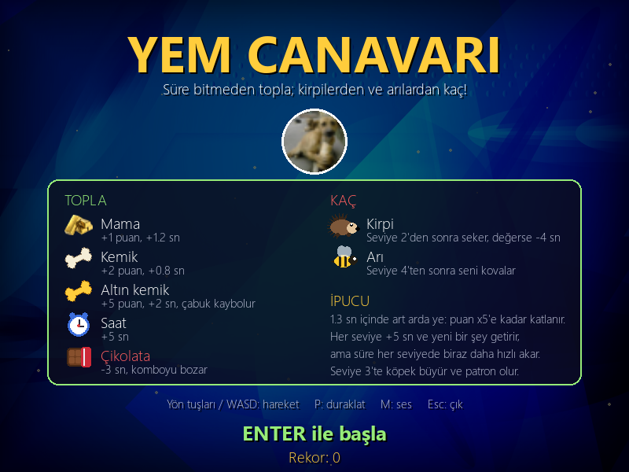
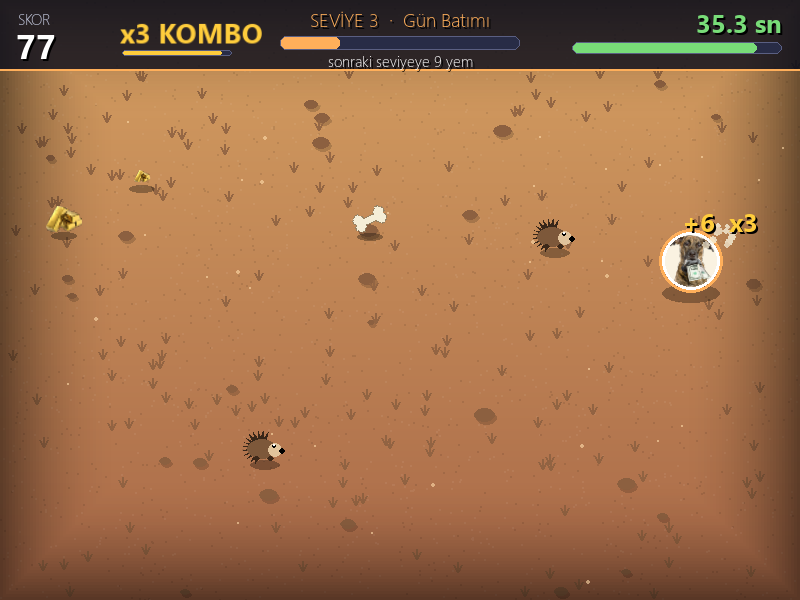
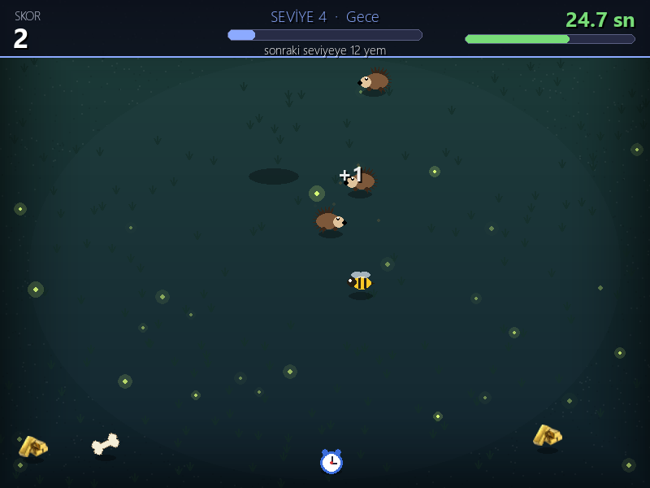
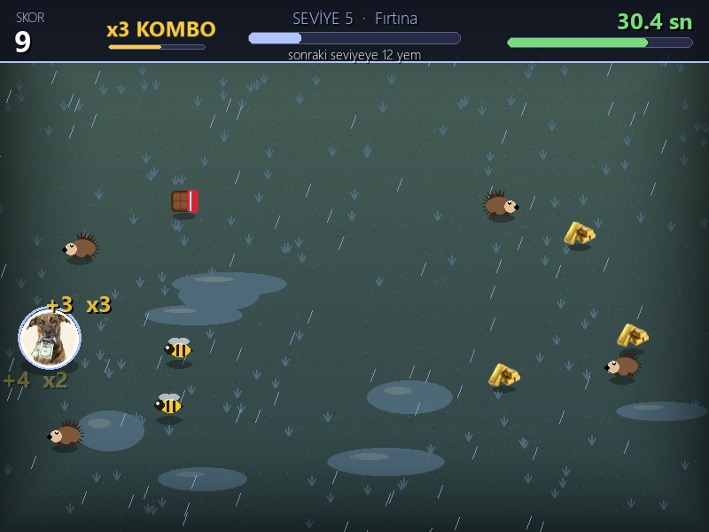

# Yem Canavarı

Python ve pygame ile yazılmış bir toplama oyunu. Köpeği yönet; süre bitmeden mamaları ve kemikleri topla, çikolatadan, kirpilerden ve arılardan uzak dur.



| Gün Batımı | Gece | Fırtına |
|---|---|---|
|  |  |  |

## Kurulum

1. Python 3.9 veya üstünü kurun.
2. Bağımlılığı yükleyin:
   ```bash
   pip install -r requirements.txt
   ```
3. Oyunu başlatın:
   ```bash
   python Oyun.py
   ```

Windows'ta `python` komutu Microsoft Store'u açıyorsa `py` kullanın: `py -m pip install -r requirements.txt` ve `py Oyun.py`.

## Kontroller

| Tuş | İşlev |
|---|---|
| Yön tuşları veya W A S D | Hareket |
| Enter veya Boşluk | Başla, devam et, yeniden oyna |
| P veya Esc | Duraklat |
| Esc (duraklatınca) | Ana menü |
| M | Sesi aç / kapat |

Pencere odağını kaybedince oyun kendiliğinden duraklar.

## Kurallar

Oyun 30 saniyeyle başlar. Süre bitince oyun biter.

| Eşya | Etkisi | İlk çıktığı seviye |
|---|---|---|
| Mama | +1 puan, +1.2 sn | 1 |
| Kemik | +2 puan, +0.8 sn; bir süre sonra kaybolur | 1 |
| Çikolata | -3 sn, komboyu bozar | 2 |
| Altın kemik | +5 puan, +2 sn; 4.5 sn içinde kaybolur | 3 |
| Saat | +5 sn | 4 |

- **Kombo:** 1.3 saniye içinde art arda yersen puan x2, x3 ... x5'e kadar katlanır.
- **Düşmanlar:** Kirpi ekranda seker. Arı seni kovalar. Değersen 4 saniye kaybedersin ve kısa bir süre korunursun.
- **Rekor:** En yüksek skor `rekor.json` dosyasına kaydedilir.

## Seviyeler

Seviye, yenen yem sayısına göre atlanır (8, 18, 30, 44, 60 ...). Her seviye +5 saniye verir, ama süre biraz daha hızlı akar.

| Seviye | Ortam | Yenilik |
|---|---|---|
| 1 | Bahçe | Mama ve kemik |
| 2 | Park | Çikolata ve ilk kirpi |
| 3 | Gün Batımı | Altın kemik; köpek büyür ve patron olur |
| 4 | Gece | Saat; arılar kovalamaya başlar |
| 5+ | Fırtına | Daha çok düşman, herkes hızlanır |

## Dosyalar

- `Oyun.py`: Oyunun tamamı. Denge ayarları dosyanın başındaki sabitlerde.
- `YemekCanavarı/`: Köpek ve mama görselleri, müzik ve sesler. Diğer görseller ve ses efektleri kodla üretilir.
- `ekran/`: README ekran görüntüleri.

#### Geliştirici
- Geliştirici: [ömer](https://www.instagram.com/bennomerrr/)
- GitHub: (https://github.com/rose-omer/)
